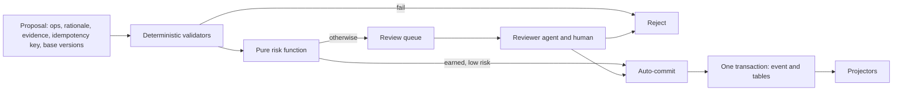

# memexvault backend architecture

The shared design for the backend specs (002-034, 037-039 and 049). [frontend-architecture.md](frontend-architecture.md) covers the console. Specs link here instead of repeating it. Update this file when a
spec changes a decision. Choices marked **provisional** wait on the named spike, which records the outcome here.

The reports in `research/` are background with unverified claims. This design adopts Postgres but not the rest of their
stack, and the numbers here are our own targets to measure.

## Requirements

- A knowledge base for AI agents, with an HTTP API and MCP, and a web console with UI for all functionality.
- A live view of processing, and a chat with an agent over AG-UI.
- Three kinds of knowledge, all linked: wiki pages, information extracted from documents, and structured entities.
- Everything is traceable to the original document or meeting recording, with bounding boxes or highlights.
- OCR of PDFs, and hybrid search that is very fast.
- An ingestion pipeline with AI extraction and review, and agents that do random checks.
- Entity types such as Product, Person and Project, plus types defined at runtime. All are searchable.
- PostgreSQL, with pgvector allowed, is the one required external system. AI calls are also allowed. Uploaded blobs live in
  folders on disk. Caches have configurable sizes.
- Backends are swappable behind traits.

## Decisions

| Topic | Decision |
|---|---|
| Language | Rust, structured by the `rust-architecture` skill. Third-party crates are allowed. |
| Storage | An event log and relational tables in [PostgreSQL](#postgresql), behind a trait. Blobs are content-addressed files in folders. Search libraries and pgvector are allowed. See [Backends](#backends). |
| AI location | OCR, embeddings and reranking default to in-process from local model files. Extraction and review agents call an LLM over HTTP (Gemini or a local OpenAI-compatible server). Transcription has local and API options. Every AI edge is a trait, so any of them can call a remote service. |
| Agent runtime | ADK-Rust `=2.3.0`, confined to one edge crate behind our own trait. Schema-only output reached 100/100 valid on Gemini and local vLLM. Extraction turns model thinking off. See spec 007. |
| Access | One server, several isolated vaults, tokens with per-vault read/propose/admin scopes, all writes attributed. No per-object ACLs, but a nullable `acl_id` leaves room. |
| PDF | `pdfium-render` on a statically linked pdfium, for text, word boxes and page images. We group characters into words. It runs in child worker processes that contain crashes and hangs. See spec 002, and specs 052 and 053 for assumptions under review. |
| OCR | `oar-ocr` with the PP-OCRv6 small detector and PP-OCRv5 Latin recognizer, 17 MB. One child process per page at 2 threads, two at a time, about 21 pages/min, with reads unaffected. Word boxes are grouped from its character boxes, and we order columns ourselves. See specs 003 and 016, 054 for old prints, and 060 for hidden-text sampling. |
| Embeddings | `multilingual-e5-small`, 384 dimensions, MIT, on ONNX Runtime through `ort` on CPU, shared with OCR. Query p95 9.4 ms on 4 threads, 40 passages/s. nDCG@10 on a 434-topic Wikipedia set: en 0.936, sv 0.897, de 0.913, es 0.911, cross-language 0.832. See spec 005. |
| Reranking | Opt-in. `mmarco-mMiniLMv2-L12-H384-v1` int8, Apache-2.0, on the top 20 at 128 tokens, p95 133 ms alone. No local model met the rerank-50 target. The server starts without its files, and a search asking for it then reports it as degraded. See specs 005, 020 and 055. |
| Vector index | pgvector 0.8.7: `halfvec(384)`, inner product, HNSW `m=16, ef_construction=128`. Unfiltered and wide filters use `ef_search=300`, recall 0.974 at p95 9.6 ms at 200k. Up to about 12,000 estimated matches, an exact scan through a B-tree. Filters matching 6 to 20% of rows have a revised target, recall ≥0.93 and p95 ≤20 ms. See specs 004 and 057. |
| Transcription | Local: `whisper-rs` =0.16.0 with `ggml-large-v3-turbo-q5_0`, 574 MB, MIT, with DTW word timing and Silero VAD. Median word start error 150-212 ms, drift at most 224 ms over 60 minutes, 15-17× real time on Metal, about 5× on CPU, up to 1.7 GB. API, off unless configured: `gemini-3.8-flash` text and speakers placed on the local model's clock, because Gemini's own word times are off by up to 80 s. Decoding is `symphonia` =0.6.1 plus `opus-rs` =0.1.41, in process, with no `ffmpeg`. Whisper can abort the process, so it runs in a worker. See specs 027 and 061. |
| Model files | Installed explicitly with a `models fetch` command using pinned hashes. The server never downloads at runtime and works offline afterwards, apart from LLM calls. |

Working assumptions: about 1M segments per vault, roughly 200,000 pages, on one machine (reference: M1 Max, 32 GB), and
the [languages](#languages) below.

Operators run Postgres and nothing else. No other server or system library is needed (libc++ and OS frameworks excepted), and AI calls are the only other
network dependency. Without the LLM endpoint, search, reading and upload still work, and extraction jobs wait and retry.

## Crates

```
crates/
  memex-types/        pure: ids, anchors, events
  memex-core/         pure: traits, Engine, reducers, validators, risk, planner, RRF, evidence assembly, page parser, type registry
  memex-api/          pure: DTOs, evidence package, and the mapping from core's results that HTTP and MCP share
  memex-store-postgres/ edge: Store on PostgreSQL
  memex-blob-fs/      edge: content-addressed blob folders
  memex-lexical/      edge: tantivy
  memex-vector/       edge: vector index on pgvector (spec 004)
  memex-pdf/          edge: PDF text, coordinates, rasterizing on statically linked pdfium, in worker processes (specs 002, 015)
  memex-ocr/          edge: oar-ocr on statically linked ONNX Runtime, in worker processes (specs 003, 016)
  memex-inference/    edge: embeddings and reranking on ONNX Runtime through ort (spec 005)
  memex-asr/          edge: whisper.cpp in worker processes, Gemini transcription, media decoding (specs 027, 028)
  memex-agent-adk/    edge: the only crate that depends on ADK-Rust
  memex-cache/        edge: RAM and disk caches
  memex-http/         frontend: axum, with routes through search so far, and serves the embedded web console from spec 037
  memex-mcp/          frontend: rmcp, eight tools and two resources on the same facade and DTOs as HTTP (spec 029)
  memexvault/         binary: the single composition root and the trait wrappers
```

Traits in `memex-core`: `Store`, `BlobStore`, `LexicalIndex`, `VectorIndex`, `PdfParser`, `Rasterizer`, `Ocr`,
`Embedder`, `Reranker`, `Transcriber`, `AgentRunner`, `Clock`, `Seed`.

`Store` speaks in domain terms: typed reads and `commit(event, mutations)`. Reducers stay pure. They read through the trait
and return typed row mutations, so all the logic runs in memory against the `MemStore` fake, and SQL lives only in
`memex-store-postgres`.

## PostgreSQL

Postgres is the system of record and the one required external system.

- **Real tables.** Each object kind has relational tables with foreign keys, so operators can inspect data with plain SQL.
  JSONB holds event payloads, and the current attributes of dynamic entities.
- **One schema per vault,** plus a `memex_server` schema for the registry. This keeps vaults isolated and lets erasure of a
  whole vault be a schema drop.
- **Migrations** are versioned SQL embedded in the binary and run by an explicit `migrate` command. The server refuses to
  start on a schema version it doesn't know.
- **Client.** The `postgres` crate, pure Rust with no `libpq`, so the binary needs no extra system library. See spec 006.
- **TLS.** rustls, with no system library. The connection URL's `sslmode` is `disable`, `require` (encrypts but checks nothing) or `verify-full` (checks the certificate against the CA file in `sslrootcert`, and the host name, which must be in the certificate's subject alternative names). With no `sslmode`, a host on this machine gets `disable` and any other host gets `verify-full`, so it needs `sslrootcert` and never falls back to plaintext. See spec 059.
- **Durability checks.** The server refuses to start if `fsync` or `synchronous_commit` is off. It can't see whether a flush reaches the drive. Docker Desktop's doesn't appear to, so it's for development. Native macOS needs `wal_sync_method=fsync_writethrough`. See specs 006 and 058.
- **Group commit.** A commit per event reaches about 400 events/s and a batch of 10 about 3,500, so one writer per vault batches what's waiting.
- **Secrets.** The connection URL arrives through `Settings` and is redacted from logs and status output.
- **Memory.** At 1M segments, `shared_buffers` of at least 2.5 GB for vector search, `maintenance_work_mem` of 1.5 GB for index builds, and `VACUUM` on vector tables runs in the background, as it took over 6 minutes after deleting 40,000 of 200,000 rows.
- **Availability.** If Postgres is down, API calls return 503 and never serve unfenced results. Writers retry, and jobs wait.

## Backends

A backend is any implementation of an edge trait, and a `[backends]` setting names each one. An unknown or uncompiled name
is a startup error.

| Trait | Default | Possible alternatives |
|---|---|---|
| `Store` | Postgres | Another SQL database, with its own SQL behind the same trait |
| `BlobStore` | Folders on disk | S3-compatible object storage |
| `LexicalIndex` | tantivy | OpenSearch, Postgres full-text |
| `VectorIndex` | pgvector | `usearch` (measured in spec 004), Qdrant |
| `Embedder`, `Reranker`, `Ocr`, `Transcriber` | Local | Remote AI services |
| `AgentRunner` | None: off until `MEMEX_LLM_PROVIDER` names `gemini` or `openai`, through ADK-Rust | Another agent library or provider |

Only the composition root knows the concrete types. A trait with several implementations gets an enum there, with one variant
per adapter, forwarding every method. Core stays generic and monomorphized, with no `Box<dyn>`. Optional adapters sit behind
Cargo features that are off by default.

**Contracts, not mechanisms.** Traits promise behaviour and never expose paths, file handles, SQL or library types. One
contract suite per trait runs against the fake and every implementation, and passing it is what makes an adapter valid.

- **`Store`:** typed reads on a consistent snapshot, batched lookups, and `commit(event, mutations)`, which is atomic and
  durable when it returns. `open_vault` takes an exclusive writer lease and refuses a second writer. `compact` physically
  removes deleted data for erasure.
- **`BlobStore`:** the default layout is `<data>/vaults/<vault-id>/blobs/ab/cd/<sha256>`, with `indexes/<kind>/gen-<n>/`, `cache/` and `tmp/` beside it. Streaming put that's durable and atomically visible on return, streaming and range reads, delete, and
  listing with age for the sweep.
- **`LexicalIndex`, `VectorIndex`:** typed queries and filters instead of engine syntax, idempotent upsert and delete by
  object id, a durable watermark, and building a new generation to flip to.

**Rules for a networked store:**

- Traits are synchronous, so pure crates stay free of an async runtime. Frontends call core on a blocking thread pool, and
  an adapter with an async client bridges internally.
- Each commit is one SQL transaction sent as one batch. The single writer per vault groups events into it.
- Reads never loop over single lookups. The fake counts store calls, so an N+1 pattern fails a test without a database.
- Parsers and OCR take bytes or streams, never paths, so they work the same with a remote blob store.

**Export and import.** The log and blobs go through the traits into a portable archive. Replay into an empty vault gives the
same canonical dump hash, and indexes rebuild from there. Events record results, so no LLM is called. This is the backup
format and the route between store implementations.

**Limits.** One server process per vault, enforced by the writer lease, which is a Postgres advisory lock. Losing the
connection loses the lease, so the writer stops until it regains it. Adding a second `Store` means rewriting its SQL, which is
real work but stays out of core.

## Data model

Each object kind has its own tables and a common header: UUIDv7, creator, status, version, nullable `acl_id`.

| Object | Purpose | Mutability |
|---|---|---|
| Source | One version of an original file, with sha256, trust tier and `recorded_at` | Immutable |
| Rendition | Parser output for a Source (parser@version, canonical text and word table blobs) | Immutable, superseded by reprocessing |
| Segment | A located, structure-bounded span of a Rendition, with its detected language | Immutable |
| Evidence | Links an Assertion to a Segment with anchor, quote and stance | Append-only |
| Assertion | One claim, literal-valued or entity-valued, with epistemic status and confidence | Never edited, only superseded or retired |
| Entity | A typed thing with aliases. Current state is materialized from its Assertions | Via merge and split events |
| EntityType | A versioned JSON Schema with field annotations | New versions only |
| Page, Block, Revision | Wiki content, edited with optimistic versions | Editable, full history |
| Edge | A typed link between objects, including wiki links and backlinks | Via events |
| ChangeSet | An atomic group of mutations with author, rationale and approval state | Append-only |
| Derivation | Records inputs, model, prompt hash and token counts of anything generated | Rebuildable |

### Anchors

Every anchor carries the source hash, rendition id, UTF-8 byte offsets into canonical text, a verbatim quote, and a
prefix and suffix.

- **PDF:** 0-based page index plus one rect per line, in displayed coordinates: after CropBox and `/Rotate`, origin top
  left, y down, integer 1/100 pt. Integers keep hashes stable. The Rendition stores each page's transform so raw PDF
  space can be recovered. OCR converts with `px * 72 / dpi` and adds a quad for skewed text.
- **Audio:** integer `t_start_ms` and `t_end_ms` on the original media timeline, with an optional speaker. See [Recordings](#recordings).
- **LLMs never emit bboxes.** They return a segment id and a quote, and our locator derives the rects.
- A new Rendition re-anchors by quote. A failure flags the claim for review.
- **Evidence gets its anchor as it commits,** on approval or auto-commit, from within the segment it cites, so the same words elsewhere in the document can't be taken for it. Evidence on a segment with no rendition has no anchor to get.

### Recordings

Spec 028. A recording takes the same path as a document, with its own job kind (`transcription`) and one worker, as one holds a large model and can take many minutes.

- **The original is the Source,** byte for byte, in the blob store. Its type comes from sniffing its container: WAV, MP3, MP4, Ogg, FLAC, WebM and Matroska.
- **The worker is a child process with saved progress,** in `<data>/vaults/<vault>/transcribe/<job>`. whisper.cpp can abort the process, so each stretch of speech is logged before and after it runs. A new process carries on from there: a stretch that crashed once runs on token times, and one that crashed twice is skipped. Both are counted in the rendition's `media`. Crashes with no progress between them end the job, and the folder goes when the job ends, as it holds the recording.
- **Memory stays flat with length.** Decoding streams to a PCM file on disk, VAD reads 5 minutes at a time, and whisper reads a stretch of at most 2 minutes. A worker over `MEMEX_TRANSCRIBE_MAX_RSS_MB` is killed and fails the job, and a recording over `MEMEX_TRANSCRIBE_MAX_SECONDS`, by default 6 hours, is refused.
- **The word table** is a `TimedDocument` in the rendition's words blob, and `media` on the row says so. The canonical text is its words with spaces, and a blank line at each change of speaker or pause of 800 ms. Speakers aren't in it, as a quote has to be what was said.
- **Segments end at turns and pauses,** joining short ones up to about 100 tokens, and a change of speaker closes one that holds 30. Only a turn over the maximum is cut inside itself. Each carries its time range, so a search's citations give one without reading the word table.
- **A cited range is its words' times, with 600 ms before and 300 ms after, inside the recording.** One function makes every range, so the transcript and provenance can't disagree. Word starts are about 170 ms late, and the padding covers that. The word table keeps the model's own times.
- **Extraction is unchanged.** It sees segments and returns quotes, and an anchor's bytes find its words. If they can't, the anchor is broken.
- **Meeting metadata** (title, date, participants) is under `meeting` in the Source's metadata, and changes by proposal, so a person's commits at once and an agent's waits. A new version of a recording keeps it. A participant links to a Person with an Edge of kind `meeting_participant` from the recording, proposed like any other, and its id comes from the recording and the participant.
- **Reading.** `/sources/{sid}/meeting`, `/transcript`, `/media` and `/stream`. `/stream` serves the original with its sniffed type and Range support, streaming, so memory stays flat, in the same sandbox as a download.
- **The API is off unless named** by `MEMEX_BACKEND_TRANSCRIBER=gemini`. A key on its own does nothing, and a worker with the API off doesn't get the key. On, a chunk with no speech is never sent, spending stops at a token limit per recording, and under 50% of its words matching the local clock fails the job. An outage waits, as with extraction. Speaker labels name their chunk, since linking them across chunks is unsolved.

### Dynamic entity types

An EntityType is a versioned JSON Schema whose fields are annotated `searchable`, `filterable` or `identity`. Additive
versions validate automatically and breaking ones need human approval. Each field value is an Assertion, so every field
is traceable to its evidence. Search uses:

- one tantivy JSON field (`attrs.<type>.<field>`),
- a rendered text card that gets embedded, and
- a Postgres table of `(type, field, text, number, time, id)` with B-tree indexes for exact and range filters.

A new type therefore needs no restart, reindex or schema migration. Spec 023 settled the details:

- **Field values are Assertions** whose subject is `entity:<id>`, so proposals, validators, evidence and review apply to them unchanged. The row, the card and the field table are all derived, and go back together on a revert.
- **Current value.** Among a field's active claims: higher epistemic status, then a person over a machine, then the newest. A claim's confidence plays no part. The row records why, and keeps the claims that lost.
- **Schemas** are closed objects (`additionalProperties: false`) in draft 2020-12, with at most 200 fields per type and 500 types per vault. Only local `$ref`s are allowed, and `jsonschema` is built without its retrieval features. Anything `classify_change` can't show to be additive counts as breaking.
- **Seed types** (Decision, Organization, Person, Product, Project) are built in as version 1 rather than written to each vault's log. Never edit one: a change is a new version.
- **Filters** are typed: `type=Product&filter=price:lt:100`. Text compares folded, and values over 512 bytes aren't in the field table. The table holds every scalar value, so a new `filterable` annotation needs no backfill.
- **A field scope** (`attr=<type>.<field>`) searches the tantivy JSON field. It's keyword only, since the vector index has no fields, and `as_of` refuses it.
- **Merges** keep the source's claims where they are: the target lists it in `merged_from`, and the source redirects while the merge stands. A split supersedes the moved claims with copies about the new entity. A revert refuses if a touched row has changed since, like any other.
- **A person.** An agent can't approve or revert a merge, a split or a breaking change, or approve a type an agent proposed, whatever its scope.

### Pages

Spec 022 settled the details:

- **Markdown is the edit format,** and a page's blocks are that Markdown split at blank lines, with each heading, rule and code fence its own block. A stored body is exactly its blocks joined, so only line endings and blank-line runs are normalized, and parsing it again gives the same blocks. An unchanged or edited block keeps its id across an edit.
- **A slug belongs to one page,** enforced by a primary key. A rename keeps the old slug as a redirect, and no other page can take it, so a link can't change meaning.
- **Links are Edges from a page to `slug:<slug>`** as written, with the block as evidence, and a `claim_ref` Edge runs from a page to a claim id. They're resolved when read, so a rename, a new page or a delete writes no one else's rows. Broken links are a query.
- **A revision is immutable** and outlives its page. Reverting a page makes a new revision from an old one. Reverting a ChangeSet is the general undo, and refuses if a touched row has changed since.
- **Claim references are read at each request,** following `superseded_by` to what stands now, so a fact can't drift. A page's search text leaves the claim out.
- **Search documents:** a page's title and headings, and each block with words of its own, under its nearest heading.
- **Limits:** 256 KB, 2,000 blocks and 2,000 links per page, 100 old slugs. A page over the byte limit is refused before anything reaches the log.
- **A page from before spec 022** has no slug or blocks until its first edit, and its body stays searchable meanwhile.

### Time

Valid time is nullable with a precision marker (day, month, unknown). Transaction time is the event sequence plus wall
time. Search indexes active claims only, with valid-time fast fields. Transaction-time `as_of` queries are served from
the store.

## Consistency

- **Log as outbox.** Each vault has an `events` table in its schema. An event commits in the same SQL transaction as its
  materialized tables. A single writer per vault assigns contiguous sequence numbers.
- **Events record results, not commands,** so replay never calls an LLM.
- **Rebuild chain:** log to tables to indexes. Bulk content stays in blobs.
- **Blob order:** write to temp, fsync, rename, fsync the directory, then commit the reference. Orphans are harmless and
  get swept after a grace period.
- **Projectors** alone write indexes, keyed by object id so they are idempotent. Tantivy keeps its watermark in the
  commit payload. pgvector keeps it in a table, and an embedded vector index would use an atomically renamed manifest. Startup replays anything above the
  watermark.
- **Embeddings** are stored by model and content hash, and made by retryable jobs that read each object's current text. A job's completion is the log event that tells the projector to write the vector, so vectors never enter the log and a rebuild embeds nothing.
- **Rebuilds** go into a new generation directory and then flip a pointer. The old generation stays for rollback.
  They page through tables with a fresh snapshot per page and catch up from the starting head, so no snapshot stays open for long.
- **Readers** fence every hit against store status. Writes return a sequence number, and `min_seq` gives read-your-writes.
- **Erasure** removes payloads and blobs, compacts the affected tables, keeps the event envelope and appends an `Erased` event.
- **Event evolution** uses upcasters, pinned by golden replay fixtures.

## Governance



- **Validators:** schema, scope, quote verification, dedup and contradiction.
- **Always human-reviewed:** merges, deletes, breaking schema changes, edits to verified claims, promoting untrusted
  sources, retiring a claim (`RetractAssertion`), and a claim arriving as `verified` from a machine or citing an untrusted source. Only a person can approve or revert these, whatever scope an agent holds.
- **Auto-commit starts off.** A combination of extractor, prompt version and type earns it when the Wilson lower bound
  of its audited precision clears a threshold. An LLM's self-reported confidence never counts. See [Review gate](#review-gate).
- **Contradictions are preserved.** Both claims stay, linked and surfaced with their sources.
- **Reversible:** every ChangeSet has a computed inverse, and a revert is itself a ChangeSet.
- **Retiring a claim.** `RetractAssertion` marks a claim `Superseded` with nothing in `superseded_by`, which means nothing stands for it now. It leaves search, entity fields and cards at once, a page's reference to it reads as missing, `as_of` still finds it at a time it stood, and a revert restores the row exactly. It may leave an entity without a required field, since a type's schema mustn't keep a wrong claim in place.

### Extraction

Spec 024. A job per Rendition sends batches of segments to the LLM, and what's valid becomes proposals. It's off unless an LLM is configured, since it sends documents to that provider.

- **The prompt comes from the type registry.** Each type is a property of the reply schema, so a new type needs no code. The prompt hash covers the instruction and the schema, so a new type is a new prompt.
- **What a model returns:** a batch-local segment id, a quote, and a claim's subject, predicate and value or an entity's type and fields. Each field becomes an Assertion, as everywhere else. No confidence is asked for, and no rectangles.
- **Quotes** must be found in the named segment, or the result is refused, recorded and never proposed. A refused quote isn't a reason to pay for a retry. The stored quote is the segment's own text.
- **Replies** that don't meet the schema retry once with the reason, and then the batch fails with its tokens on record. The other batches go on, and the document ends `partial`. If every batch fails, the job goes dead, and the document is `failed`.
- **A Derivation per batch** holds the model, prompt hash, segments, token counts, results and refusals. It commits before its proposals are made, so a crash costs no second call, and no event needs an LLM to replay.
- **Idempotency.** A proposal's key is the rendition and the fact, not the prompt, model or quote, so the same fact is proposed once however many runs find it. Segments with results for this prompt aren't sent again, so a re-run with nothing new costs nothing.
- **The budget** is per document, per run, counting input, output and thinking. A call that wouldn't fit by estimate isn't made, and its output limit shrinks to what's left. A document that stops there is `partial`, and a re-run is the decision to spend more.
- **An LLM outage** sends the job back to wait, taking its attempt back, so no outage can use up its attempts, with a delay of at most 5 minutes. Waiting extractions don't count as upload backlog. A refusal by the provider is an ordinary failure with attempts.
- **Identity resolution** names existing entities sharing an identity value as candidates, in the Derivation and the proposal's rationale. It never merges.
- **Long calls.** The holder extends its job lease before each call, by twice the call's time limit plus 30 s, as a call can outlast the usual 60 s lease.

### Review gate

Spec 025. Everything pending is the queue, in `/vaults/{id}/review`, with filters, counts and batches.

- **The reviewer agent** runs as a job per queued machine proposal with claims, off unless `MEMEX_REVIEW_MODEL` is set. It sees each claim and its quote and nothing else, has no tools, holds no token, and writes only its own verdict. A verdict is advice for a person: it commits nothing, rejects nothing and never counts as a sample. An outage leaves the job waiting and the item in the queue, where people can still decide it.
- **Samples** are a person's decisions on a machine's proposal: approved counts as correct, and rejected, edited or a reverted auto-commit as wrong. Audits add theirs through `record_audit_samples`. An agent's decision, a verdict, an always-review change and clearing a stale proposal all count for nothing.
- **A combination** is the model behind an extraction, or otherwise the proposing principal, with the prompt hash and the item type (`claim`, `entity:<type>`, `page`, `link`, `source`). A ChangeSet needs every type it touches earned. The prompt hash covers the type registry, so a new entity type is a new prompt, and every combination earns again from nothing.
- **On or off** is worked out from the counts and the threshold on each read, so it can't drift from them. Falling below turns it off, and good samples can bring it back. A manual disable starts the counts again, keeping totals for the record, and there's no way to turn one on by hand.
- **Never auto-commits, however much is earned:** a machine's claim citing any source below `trusted`, so both `untrusted` and `unverified`, or one with no source row to show its tier, invisible characters, or a page flagged for hidden text. The user decided the bar is `trusted`. So auto-commit only ever applies to sources a person has marked `trusted` or `verified`, and everything else waits for a person however good its combination's record. An agent can't get a source there itself: it can't upload at those tiers, and its request to raise a source needs a person's approval. This limits where a planted instruction can act, and nothing judges the text itself.
- **The remaining limit:** a planted sentence in plain view, in a source a person marked `trusted`, looks like any other claim once its combination has earned it. It commits as `asserted`, can touch nothing else, and it's the audit's to find.
- **Decisions.** Every one has who, when and why: a person, `auto-commit` with its counts and bound, `validators`, or `pipeline`. Asking for the same decision again changes nothing, while someone else's decision on the same item is a conflict that names them. An edit keeps what was proposed on the row, and only a person can make one.
- **A replaced rendition.** Evidence must cite a document's current rendition, so a proposal on an old one can't be approved. The new rendition's extraction run retires extraction's pending proposals on old ones, without counting against the extractor, and proposes what's still there. Other proposals stay, for a person to clear.

### Audit agent

Spec 026. Runs on a schedule, or on demand, with a seed and a token budget, sampling the claims that stand and checking them against their sources. It's off until someone writes a schedule. It has no token: a job of the server's own that acts as a machine principal holding `propose` scope, and its results are events like anything else, so replay calls no LLM.

- **The sample** is a pure function of the seed and the vault's claims, weighted toward recent auto-commits and toward rare extractors, rare types and low trust, by exponential keys, so the order rows arrive in can't matter. Age counts from the newest commit in the vault rather than from the clock, so the same seed on the same state gives the same sample next week, whether scheduled or from the route.
- **Deterministic checks** cost no tokens: quote relocation, link rot (a segment, source or bytes gone, and page links that lead nowhere), staleness (a per-predicate TTL in days, or a claim's own validity ending), and index reconciliation. Reconciliation compares a count and an order-independent hash of ids between the store and each index, and asks the keyword index about each sampled claim. Events since an index's watermark that touched nothing it holds don't count against it, and otherwise the answer is inconclusive rather than a finding.
- **LLM checks** are off unless `MEMEX_AUDIT_MODEL` is set: isolated entailment of the claim against its quote, then blind re-extraction of the segment, shown nothing about the claim, and compared with it. Tools are never offered, and replies must match their schema.
- **Budgets.** Per run and per UTC day, on the schedule. A call that wouldn't fit either isn't made. Running out, an outage or a provider's refusal ends the LLM checks and not the run, which finishes with its deterministic results and says why it stopped.
- **Findings become review items,** as a `RetractAssertion` proposal through the ordinary gate, one per claim ever, with a person deciding. A vault-level finding, or a claim only an index has lost, has nothing to retire, and shows on the run.
- **What revokes.** Only a quote that fails on the rendition the claim cites, or a `not_entailed` answer, and only for a machine's combination. It records an incorrect sample and, if the combination had earned auto-commit, disables it at once however good its record, so its counts start again and only new samples can earn it back. Link rot, a quote lost because the source was replaced or re-rendered, staleness, a blind re-extraction's disagreement alone and index drift are findings and revoke nothing, since they aren't shown to be the extractor's error.
- **What earns.** A claim gives its combination one correct sample, once, and only with an entailment and no failure, because a quote that's where it says proves nothing the validators hadn't already checked.
- **Siblings** are a revoked combination's auto-committed claims that still stand, requeued as `RetractAssertion` items, at most 200 per run. A cursor holds the place and each run reports what's left, so later runs carry on until the combination is covered, including runs that found nothing wrong.
- **A person's decision on an audit item.** Keeping a claim is a correct sample for its combination. Retiring a sibling or a claim only a blind re-extraction disagreed with is an incorrect one, while retiring a finding the audit already counted adds nothing, and neither does anything for a person's own claim. An agent's decision counts for nothing. A claim a person kept isn't asked about or counted against again.
- **Missed slots** aren't caught up: one run goes, and the slots passed over are counted. A slot that finds a run still open is passed over and counted too.
- **Planted errors** measure recall in a test vault, one marked as such while empty, as planting writes straight to rows. The report keeps kinds the deterministic checks catch apart from kinds only LLM checks can, and it won't judge the 80% target until a real model has answered, as scripted answers prove the mechanism and say nothing about a model.
- **The known limit** is a false sentence in plain view in a trusted source, quoted faithfully. Every check passes it, as it would have to compare sources to find it.

### Prompt injection

Ingested content is data. A verified quote can still carry a planted falsehood, so the controls limit capability
instead of trying to detect bad text:

- Extraction runs with no tools and schema-only output.
- Reviewers see only the claim and its quote.
- Agents can't fetch URLs.
- Untrusted sources can't reach `verified` automatically, and a machine's claims from any source below `trusted` can't auto-commit.
- Invisible Unicode and text-layer content that OCR can't see gets flagged.
- Evidence packages expose trust tier and epistemic status.
- Tool descriptions are never built from vault content.

## Languages

English, Swedish, German and Spanish are the tested languages. Other Latin-script languages work with weaker keyword
matching, and other scripts aren't supported yet. Documents can mix languages, and a vault is never tied to one.

- **Detection.** Each Segment stores a detected language. Low confidence is stored as unknown, because short text is often
  misdetected.
- **Keyword search.** Every segment goes into a language-neutral field and a diacritic-folded field, so `ORA-00904` matches
  literally and `Goteborg` still finds `Göteborg`. Segments in a tested language also go into that language's stemmed field,
  with å, ä, ö, ü, ß and ñ kept. A query runs against all these fields, because its language can't be reliably detected.
- **Common terms.** With at least 10,000 documents, a query drops single-term clauses matching over 4% of documents, unless all of
  them are common. Spec 018 needed this for whole-sentence queries to meet the latency target.
- **Current rows only.** The keyword index holds Active, non-superseded rows on the current rendition, so it has no status field.
  `as_of` for retracted rows replays the log instead (see [Search](#search)).
- **Compound words.** German and Swedish join words, and stemming doesn't split them. Decompounding is added only if the golden
  set shows a measured need.
- **Vector search and reranking** use multilingual models, so a question in one language can find text in another.
- **Claims** keep the source language, and quotes stay verbatim. Translating them would break quote verification.

## Search

Intent is classified by deterministic rules, with no LLM on the read path:

1. Exact id or field lookups go straight to the store.
2. Otherwise lexical and vector candidates, plus entity lookup, are fused with Reciprocal Rank Fusion.
3. Optional k-hop expansion over Edges for relational queries. It's off unless a request asks with `expand=on`, as spec 022's measurement missed its latency condition.
4. Hits are fenced against the store on one snapshot, taken after the candidates, so anything retracted meanwhile is gone.
5. Optional cross-encoder rerank of the top 20.
6. Hits are assembled into a token-budgeted evidence package with claims first, citations, conflicts and trust notes.

`GET /api/v1/vaults/{id}/search` is the one search API. Spec 020 has its measurements: recall@20 97.5% on the golden set at 200k, and p95 31 ms with 1 client, but 81 ms with 8, against the ≤50 ms target, which spec 062 reviews. The rules behind it:

- **Filters** are kind, type, source, trust tier, epistemic status and valid time. Type is a segment's media type, a claim's predicate or an entity's type. Kind includes `entity`, `page` and `block`. The fence checks them again on current rows, so a changed trust tier can't leak.
- **A failed signal degrades the search.** Hybrid answers from the other signal and names the failed one in `degraded`. If both fail, it returns 503, and it never serves unfenced results.
- **`min_seq`** is read-your-writes for the keyword index. The vector index has seen the event by then, but new text may still wait for its embedding job, and keyword search finds it meanwhile. A sequence the log hasn't reached is a 400, and one the indexes don't reach in time is a 503 with the code `not_caught_up`.
- **`as_of`** takes an event or a time, and the log answers it. Past rows aren't in any index, so the events up to that point are replayed into memory and scanned for keywords, with no stemming, vectors or reranking. Its cost grows with the log, so at most two run at once, and more return 429.
- **Budgets are estimates**, at 4 characters per token, since the read path has no tokenizer. A text is never cut, because a shortened quote can't be verified. An item that doesn't fit ends the page.
- **Cursors** hold a rank and don't expire. A page read after writes reflects the ranking at that moment.
- **Entity lookup** is the third signal: a query that is exactly an identity value or alias counts as a first-place hit for that entity, at one more store call per search.
- **Segment citations** give offsets and pages, not rectangles, because rectangles would need the word table on every search. Claim citations carry their stored rectangles.

## API conventions

All HTTP routes sit under `/api/v1`. The OpenAPI document is generated from code and is the contract: the frontend's types are generated
from it.

- **Lists** take a cursor, a limit, a stated sort and typed filters. They return a total only where it's cheap to compute.
- **Long operations** return a job id, and their progress appears in the jobs API and the activity stream.
- **Errors** use the one format from spec 012.
- **Writes** to knowledge objects are proposals, as in [Governance](#governance).
- **Browsers** authenticate with a session cookie (spec 037). API and MCP clients use bearer tokens. Both resolve to the same principal and
  scopes. `POST /api/v1/session` exchanges a token for a session, `DELETE` ends it, and `/api/v1/whoami` answers for both.
- **Sessions** last 12 hours, are stored as hashes in `memex_server.sessions`, and pass the token's checks on every request, so revoking the token or disabling the principal ends them at once.
- **CSRF.** The cookie is `SameSite=Strict`, and any state-changing request a cookie would authorize, and signing in, needs an `x-memex-csrf` header. A bearer header decides alone when present, and needs no such header.
- **Failed sign-ins** are limited to 10 a minute per peer address, in memory, and then return 429 with `Retry-After`, even for the right token. Behind a proxy all clients share one count.
- **TLS** belongs to a proxy in front. It must send `X-Forwarded-Proto: https`, which is what makes the cookie `Secure`.
- **Every response** carries a CSP with `default-src 'self'` and `frame-ancestors 'none'`, plus `nosniff`. Original files download as attachments with a `sandbox` CSP. Unknown paths outside `/api` return the console's `index.html`.

## MCP

Spec 029. Tools are `search`, `get`, `neighborhood`, `resolve`, `propose`, `ingest`, `changes` and `provenance`, each calling the facade HTTP calls and answering with its DTOs. `detail=detailed` is exactly the HTTP body, and `concise`, the default, drops fields a model rarely needs. Page and source text are resources at `memex://vaults/{vault}/pages/{id}` and `.../sources/{id}`, and `memex://vaults` lists what the token sees.

- **Transports.** Streamable HTTP at `/api/v1/mcp`, stateless and in JSON, so the server holds nothing per client, with a bearer token checked on every request. Cookies aren't accepted. `MEMEX_MCP_ALLOWED_HOSTS` names the hosts it answers to, by default only this machine's, which stops DNS rebinding, so a proxy's host name has to be added. `memexvault mcp` is stdio with `MEMEX_MCP_TOKEN`, checked at every call. It's the whole server, workers included, for one local client, and since a vault has one writer it refuses to start beside `serve`.
- **Definitions are static.** `tools.json` is compiled in and a test pins its hash, so nothing in a vault can reach what an agent reads before it asks for anything. The list is 1,238 tokens with `cl100k_base`, against a limit of 2,000.
- **Results are data.** Every answer is `{notice, trust_tiers, data}`, and a document's text sits inside a JSON string under `data`.
- **Size.** An answer is at most 64 KiB, with a cursor for the rest. A list keeps what fits, and an item too large for any page is named with its short fields and passed over, as a text is never cut. Search budgets are clamped to a quarter of that many tokens. A long page comes as its blocks, and resources come in slices that name the next.
- **`vault`** can go unnamed when the token sees exactly one. Otherwise the error lists what it sees, and only that.
- **`ingest`** takes up to 8 MiB in a request. Larger files go through the upload route, which streams.
- **Errors** are tool results in the API's format, with the same codes and messages. Unknown tools and impossible resources are protocol errors.
- **`neighborhood`** is `GET /vaults/{id}/objects/{oid}/neighborhood`: one hop, both ways, through any slug a page has had. Kinds default to `wiki_link`, `claim_ref` and `contradicts`, and a caller names any others, since the store reads edges by kind.

## Live activity

One server-sent event stream per vault feeds the console's live views, at `GET /api/v1/vaults/{id}/activity` (spec 038). It carries metadata only, never document content. `GET /vaults/{id}/activity/documents` is the snapshot: each document's stage and the log's `head`, to follow from with `?after=`.

- **Frames are built field by field** from a fixed list in `memex-api`: ids, kinds, stages, counts and timings. Names, metadata, error messages, quotes and failure reasons have no field to go in. An event kind nobody listed reads as `other`, and a new row kind won't compile until it's listed, where the easy choice is to count it. An id goes through only if it looks like one, so a link's `slug:` target can't.
- **Durable events** come from the log and resume by sequence number, from `Last-Event-ID` or `?after=`, so a reconnect misses nothing. Their sequence is the frame's id, and -1 is before the first event.
- **Progress messages,** such as OCR page 12 of 400, are in memory only and may be dropped. They go through the `Progress` trait, whose update has no field for text. It's a board on the `Server`, not an edge type on `ServerEdges`, as it holds no IO. Workers finishing a job clear its report.
- **Each document has a stage model:** stored, parsing, OCR or transcription, segmenting, indexing, embedding, extraction, review, done. Failed, partial, waiting and retrying are visible states. The earliest unfinished work decides, so a later stage can't hide an earlier failure. It's pure, in `memex-core`. Indexing compares a rendition's time with the time of the event the slowest index has reached, since a row doesn't record its commit's sequence, so it can read as past indexing for the moment between building a rendition and committing it.
- **One reader per vault.** A task per followed vault looks at the log's head every 200 ms in one statement with no transaction, and reads a page only when it moved. Waiting clients hold no Postgres connection and no lease. It keeps the last 4,096 frames, so most reconnects read nothing. Older positions read the log a page at a time, two clients at once over the whole server.
- **A slow client never slows ingest.** Nothing here touches the writer. Each client's buffer is bounded (1,024 frames, 1 MiB), and overflow drops what's waiting and sends a resync frame at the current position, which makes the client fetch a new snapshot. A pure policy decides, and progress and heartbeats are dropped first.
- **A client that never reads can't hear a resync,** and hyper stops polling a response while a write is stuck, so the connection itself is watched: writes refused for 30 s close it. Only a stream's connection is watched, so a paused download isn't touched.
- **Scope.** Checked at open, then each distinct credential every second by the same reader, one after another, so a token revoked, a session ended, a principal disabled, a grant removed or a token expiring ends the stream with an `end` frame and a reason, and nothing follows it. What's waiting in its buffer is dropped too. Frames can still go out until the next check, so for at most a second after the change. If the store can't answer, a stream goes on for up to 10 s and then ends.
- **A position that can't be resumed from gets a resync, not an error:** one ahead of the log, one that isn't a number, or one the log no longer holds, which is any gap in the sequence. A new cache generation does the same for every open stream and empties the frames in memory, which is how erasure (spec 030) reaches this: **it must call `bump_cache_generation`,** as it already has to for the caches. It can keep or remove envelopes, since either reads correctly: an emptied payload gives a frame with no details, and missing rows give a resync.
- **A limit per principal** of 16 streams over all vaults. The next is refused with 429 and the code `too_many_streams`.
- **Shutdown** ends every stream, as graceful shutdown would otherwise wait for them for ever.

## Chat agent

A separate, opt-in surface (spec 049). It's off per vault until an admin enables it, because it sends vault content to the configured LLM, and the server has no agent at all unless `MEMEX_CHAT_MODEL` names a model. The search path stays free of LLMs, and the chat agent calls search like any other client.

- **Protocol.** AG-UI over server-sent events, at `POST /vaults/{id}/chat/runs`. `AgentRunner::chat` runs on ADK's `Runner` in `memex-agent-adk`, a `ChatHost` from core decides what each model call may spend and runs the tools, and a pure mapper turns its events into AG-UI's. ADK `=2.3.0` streams text deltas and tool events only while the agent has no output guardrails, so there are none. See spec 034.
- **Tools.** `search`, `read`, `provenance` and `propose`, compiled in with a pinned hash, and each answer is `{notice, trust_tiers, data}`. They run as the person asking, whose token is read fresh at every model call and tool call, and they can't reach above `propose` however much that person holds. None takes a URL, and a tool that doesn't exist is an error for the model to read.
- **Changes** go to the normal review queue, attributed to `chat-agent` with the person in `requested_by`, and only a person approves them. Runs don't pause for approval, and AG-UI interrupts aren't used. **A chat proposal never auto-commits, whatever the combination has earned, and neither a decision on one nor an audit of its claim counts as a sample.** A chat answers one person's question, which isn't the kind of output a combination's record is about.
- **Threads** are `(owner, id)`, so the same id under another principal is another thread and nobody can reach another's, server admins included. They live in the vault's schema, **off the event log**, as a copy in the log would outlive their deletion, so they aren't in an export. They aren't indexed for search, and no index holds their content. A thread's history is what the server stored: a client's `messages` other than the newest user message are ignored.
- **The log holds only ids and counts.** The vault's setting and each run's Derivation (kind `chat_run`, with the model, prompt hash, tokens and the segments it read) are events. A run's Derivation holds no text, so it can outlive its thread.
- **Erasure.** `Server::erase_chat_threads_citing` deletes every thread a source's content reached, through any tool, whether or not a reply cited it, because a reply may paraphrase in ways a byte scan can't find. A source is recorded before a tool's answer goes anywhere, and then checked to be still there. `Store::compact` rewrites the chat tables, as plain `VACUUM` leaves a dead row's bytes on its page. Spec 030 still has to call this. Postgres's WAL and backups keep what they kept.
- **Budgets.** Per thread and per vault per UTC day, set per vault or by server default. Each call reserves its estimated input and its output limit before it's made, in one transaction on the thread and the day, so concurrent runs can't both take what's left, and a call that can't fit isn't made. What the provider reports replaces the reservation. A provider that doesn't report, or a cancelled call, is charged an estimate that errs high and is never zero: input at 3 characters per token, and output from what was seen. A crash leaves the reservation charged. Deleting a thread gives no budget back.
- **Ending a run.** A client going away cancels it, and it can't be resumed. A budget, a cancel, a call limit or a reply cut at its limit is a `RUN_FINISHED` whose `result.stop` says why. A provider's failure, or a model that finishes having said nothing, is a `RUN_ERROR` with a fixed message and a code, and the provider's text stays in the server's log. What was said before the end is kept, marked with why.
- **Connections.** A run holds no connection, transaction or lock while the model works, and a run takes a slot of `MEMEX_CHAT_MAX_RUNS`, beyond which it's refused with 429.
- **Thinking stays off,** as in extraction: `enable_thinking: false` on a local server and the lowest level on Gemini. It multiplied tokens in spec 007, it spends the same budget as the reply, and the first visible text would wait behind it. Thinking parts are never shown or stored.

## Targets

These are goals at 1M segments, warm, on the reference machine, with default backends and Postgres on the same machine. A
spike may revise a target with a recorded reason.

**Test scale.** Until spec 033, specs measure at 200k segments and also at 50k, with at most 20 GB of test data on disk, including
Docker volumes but not Rust build output. Each spec records the growth from 50k to 200k and a projection to 1M. A result passes
when it meets the target at 200k. A projection that misses the target at 1M is raised with the user. A projection isn't a
measurement: only spec 033 proves the 1M goal.

| Metric | Target |
|---|---|
| Exact lookup p95 | ≤2 ms |
| Lexical search p95 | ≤15 ms |
| Hybrid without rerank p95 | ≤50 ms |
| Hybrid with rerank-20 p95 (opt-in) | ≤300 ms |
| Cached query p95 | ≤1 ms |
| Search p95 during ingest | ≤1.5× idle |
| Group commit | ≥1k events/s |
| Restart without models, Postgres already up | ≤3 s |
| Lexical rebuild | ≤15 min |
| memexvault RSS excluding models (Postgres recorded separately) | ≤4 GB |
| Machine claims with resolvable anchors | 100% |

## Caches

Each tier has a configurable byte cap, and 0 turns it off. Tantivy's mmap stays with the OS page cache. Spec 021 has the measurements.

| Tier | Setting, default | Contents | Key includes |
|---|---|---|---|
| Query (RAM, moka) | `MEMEX_CACHE_QUERY_BYTES`, 256 MiB | Evidence packages | The log's head, the index watermarks, or the past event for `as_of`, and the whole request |
| Inference (RAM, moka) | `MEMEX_CACHE_INFERENCE_BYTES`, 64 MiB | Query embeddings, rerank scores | Model, and a hash of the query or of the query and all its passages |
| Objects (RAM, moka) | `MEMEX_CACHE_OBJECT_BYTES`, 256 MiB | Segments, entities and pages the fence reads | Id, and a stamp of the row's contents |
| Disk (LRU files) | `MEMEX_CACHE_DISK_BYTES`, 2 GiB | Page images, word tables | Blob hash, and DPI, renderer and highlights for an image |

Every key starts with the vault and its generation, which erasure bumps. That covers the one case the rest of a key doesn't. A key holds everything its value depends on, so a stale value is unreachable and ages out. Rules behind this:

- **The head is in the query key.** A watermark alone would let a package outlive a retraction until the index catches up. So any event misses, and hits need a quiet log.
- **A row's stamp isn't its version.** Reverting a ChangeSet restores a row with its old version number, and the next edit uses that number again for new content. Postgres hashes the row, so the row doesn't cross the network.
- **Marks are read before a hit is served,** in one statement. The keyword index's watermark is in memory, and so is the vector index's, as only this server's projector writes it. If they can't be read, nothing comes from a cache, and the search reports the failure as it would have. A hit reads no rows.
- **Not kept:** a degraded answer, a `debug` search (its timings are its own) and a `min_seq` search.
- **Eviction is LRU,** not moka's default TinyLFU, which would hold on to popular keys that can never be read again. An entry over a twentieth of its tier's cap isn't kept, so a tier can only pass its cap by that much, and only until the eviction that follows.
- **The disk tier** keeps its files in each vault's `cache/` folder, under one cap, and each file holds its key and a digest. A file that fails either is a miss and is deleted.
- **A bump** (`Server::bump_cache_generation`) is durable first, then drops the vault's RAM entries and files, so erased content doesn't stay on disk. `GET /api/v1/caches` shows counts and sizes to server admins.

## Left out

| Left out | Why |
|---|---|
| redb and a storage layer of our own | Replaced by Postgres, which gives us durability, SQL inspection and tooling. |
| Postgres full-text search | tantivy gives BM25 and exact identifier tokens, and has to meet the lexical target. A trait keeps this replaceable. |
| S3, OpenSearch | Not needed. They're possible later as [backends](#backends). |
| Kafka/Debezium, Neo4j, Apache AGE | No trait they would sit behind. The log is the outbox, and Edges cover k-hop. |
| Active-active servers on one vault | The single writer underpins sequence order and group commit. |
| OpenFGA or ReBAC, ACL pre-filtering | Physical vault isolation replaces them for now. |
| DiskANN | Not needed at this scale. |
| GraphRAG community summaries | High token cost. Start with k-hop, and add more only after a measured golden-set gain. |
| ColPali and other visual retrieval | Large vector storage cost. Page images are kept, so it can come later. |
| In-process vision-language parsers | Too heavy. Reconsider only if spec 003 fails. |
| LLMs on the search path, including `kb.ask` and LLM planners | They break the latency targets, and the calling agent does the generation. Chat is a separate opt-in surface that calls search like any client. |
| Query DSL | Typed filters instead. |
| CRDTs | Optimistic versions are enough. |
| Automatic entity merges | Merges are always human-approved. |
| Agent Memory and Episode kinds, reputation scoring | Not required. The kind enum stays extensible. |

## Spec map

| Area | Specs |
|---|---|
| Spikes | 002-007, 027 |
| Foundation | 008, 009, 032, 011-014 (010 dropped) |
| Documents and provenance | 015-017 |
| Search and caching | 018-021 |
| Pages and entities | 022, 023 |
| Agents | 024-026, 028 |
| MCP, operations, acceptance | 029-031, 033 |
| Support for the console | 034, 037-039, 049 |
