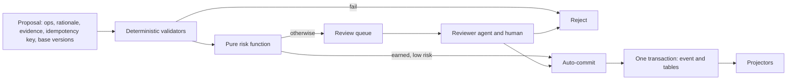

# memexvault backend architecture

The shared design for the backend specs (002-034, 037-039 and 049). [frontend-architecture.md](frontend-architecture.md) covers the console. Specs link here instead of repeating it. Update this file when a
spec changes a decision. Choices marked **provisional** wait on the named spike, which records the outcome here.

The reports in `research/` are background with unverified claims. This design adopts Postgres but not the rest of their
stack, and the numbers here are our own targets to measure.

## Requirements

- A knowledge base for AI agents, with an HTTP API and MCP, and a web console with UI for all functionality.
- A live view of processing, and a chat with an agent over AG-UI.
- Three kinds of knowledge, all linked: wiki pages, information extracted from documents, and structured entities.
- Everything is traceable to the original document or meeting recording, with bounding boxes or highlights.
- OCR of PDFs, and hybrid search that is very fast.
- An ingestion pipeline with AI extraction and review, and agents that do random checks.
- Entity types such as Product, Person and Project, plus types defined at runtime. All are searchable.
- PostgreSQL, with pgvector allowed, is the one required external system. AI calls are also allowed. Uploaded blobs live in
  folders on disk. Caches have configurable sizes.
- Backends are swappable behind traits.

## Decisions

| Topic | Decision |
|---|---|
| Language | Rust, structured by the `rust-architecture` skill. Third-party crates are allowed. |
| Storage | An event log and relational tables in [PostgreSQL](#postgresql), behind a trait. Blobs are content-addressed files in folders. Search libraries and pgvector are allowed. See [Backends](#backends). |
| AI location | OCR, embeddings and reranking default to in-process from local model files. Extraction and review agents call an LLM over HTTP (Gemini or a local OpenAI-compatible server). Transcription has local and API options. Every AI edge is a trait, so any of them can call a remote service. |
| Agent runtime | ADK-Rust, confined to one edge crate behind our own trait. |
| Access | One server, several isolated vaults, tokens with per-vault read/propose/admin scopes, all writes attributed. No per-object ACLs, but a nullable `acl_id` leaves room. |
| Model files | Installed explicitly with a `models fetch` command using pinned hashes. The server never downloads at runtime and works offline afterwards, apart from LLM calls. |

Working assumptions: about 1M segments per vault, roughly 200,000 pages, on one machine (reference: M1 Max, 32 GB), and
the [languages](#languages) below.

Operators run Postgres and nothing else. No other server or system library is needed, and AI calls are the only other
network dependency. Without the LLM endpoint, search, reading and upload still work, and extraction jobs wait and retry.

## Crates

```
crates/
  memex-types/        pure: ids, anchors, events
  memex-core/         pure: traits, Engine, reducers, validators, risk, planner, RRF, page parser, type registry
  memex-api/          pure: DTOs, evidence package
  memex-store-postgres/ edge: Store on PostgreSQL
  memex-blob-fs/      edge: content-addressed blob folders
  memex-lexical/      edge: tantivy
  memex-vector/       edge: vector index, pgvector preferred (provisional, spec 004)
  memex-pdf/          edge: PDF text, coordinates, rasterizing (provisional, spec 002)
  memex-ocr/          edge: OCR engine (provisional, spec 003)
  memex-inference/    edge: embeddings and reranking (provisional, spec 005)
  memex-asr/          edge: transcription (provisional, spec 027)
  memex-agent-adk/    edge: the only crate that depends on ADK-Rust
  memex-cache/        edge: RAM and disk caches
  memex-http/         frontend: axum, and serves the embedded web console
  memex-mcp/          frontend: rmcp
  memexvault/         binary: the single composition root and the trait wrappers
```

Traits in `memex-core`: `Store`, `BlobStore`, `LexicalIndex`, `VectorIndex`, `PdfParser`, `Rasterizer`, `Ocr`,
`Embedder`, `Reranker`, `Transcriber`, `AgentRunner`, `Clock`, `Seed`.

`Store` speaks in domain terms: typed reads and `commit(event, mutations)`. Reducers stay pure. They read through the trait
and return typed row mutations, so all the logic runs in memory against the `MemStore` fake, and SQL lives only in
`memex-store-postgres`.

## PostgreSQL

Postgres is the system of record and the one required external system.

- **Real tables.** Each object kind has relational tables with foreign keys, so operators can inspect data with plain SQL.
  JSONB holds event payloads, and the current attributes of dynamic entities.
- **One schema per vault,** plus a `memex_server` schema for the registry. This keeps vaults isolated and lets erasure of a
  whole vault be a schema drop.
- **Migrations** are versioned SQL embedded in the binary and run by an explicit `migrate` command. The server refuses to
  start on a schema version it doesn't know.
- **Client.** A pure-Rust client with no `libpq`, chosen in spec 006, so the binary needs no extra system library.
- **Durability checks.** The server refuses to start if `fsync` or `synchronous_commit` is off.
- **Secrets.** The connection URL arrives through `Settings` and is redacted from logs and status output.
- **Availability.** If Postgres is down, API calls return 503 and never serve unfenced results. Writers retry, and jobs wait.

## Backends

A backend is any implementation of an edge trait, and a `[backends]` setting names each one. An unknown or uncompiled name
is a startup error.

| Trait | Default | Possible alternatives |
|---|---|---|
| `Store` | Postgres | Another SQL database, with its own SQL behind the same trait |
| `BlobStore` | Folders on disk | S3-compatible object storage |
| `LexicalIndex` | tantivy | OpenSearch, Postgres full-text |
| `VectorIndex` | pgvector if it passes spec 004 | Embedded index, Qdrant |
| `Embedder`, `Reranker`, `Ocr`, `Transcriber` | Local | Remote AI services |

Only the composition root knows the concrete types. A trait with several implementations gets an enum there, with one variant
per adapter, forwarding every method. Core stays generic and monomorphized, with no `Box<dyn>`. Optional adapters sit behind
Cargo features that are off by default.

**Contracts, not mechanisms.** Traits promise behaviour and never expose paths, file handles, SQL or library types. One
contract suite per trait runs against the fake and every implementation, and passing it is what makes an adapter valid.

- **`Store`:** typed reads on a consistent snapshot, batched lookups, and `commit(event, mutations)`, which is atomic and
  durable when it returns. `open_vault` takes an exclusive writer lease and refuses a second writer. `compact` physically
  removes deleted data for erasure.
- **`BlobStore`:** streaming put that's durable and atomically visible on return, streaming and range reads, delete, and
  listing with age for the sweep.
- **`LexicalIndex`, `VectorIndex`:** typed queries and filters instead of engine syntax, idempotent upsert and delete by
  object id, a durable watermark, and building a new generation to flip to.

**Rules for a networked store:**

- Traits are synchronous, so pure crates stay free of an async runtime. Frontends call core on a blocking thread pool, and
  an adapter with an async client bridges internally.
- Each commit is one SQL transaction sent as one batch. The single writer per vault groups events into it.
- Reads never loop over single lookups. The fake counts store calls, so an N+1 pattern fails a test without a database.
- Parsers and OCR take bytes or streams, never paths, so they work the same with a remote blob store.

**Export and import.** The log and blobs go through the traits into a portable archive. Replay into an empty vault gives the
same canonical dump hash, and indexes rebuild from there. Events record results, so no LLM is called. This is the backup
format and the route between store implementations.

**Limits.** One server process per vault, enforced by the writer lease, which is a Postgres advisory lock. Losing the
connection loses the lease, so the writer stops until it regains it. Adding a second `Store` means rewriting its SQL, which is
real work but stays out of core.

## Data model

Each object kind has its own tables and a common header: UUIDv7, creator, status, version, nullable `acl_id`.

| Object | Purpose | Mutability |
|---|---|---|
| Source | One version of an original file, with sha256, trust tier and `recorded_at` | Immutable |
| Rendition | Parser output for a Source (parser@version, canonical text and word table blobs) | Immutable, superseded by reprocessing |
| Segment | A located, structure-bounded span of a Rendition, with its detected language | Immutable |
| Evidence | Links an Assertion to a Segment with anchor, quote and stance | Append-only |
| Assertion | One claim, literal-valued or entity-valued, with epistemic status and confidence | Never edited, only superseded |
| Entity | A typed thing with aliases. Current state is materialized from its Assertions | Via merge and split events |
| EntityType | A versioned JSON Schema with field annotations | New versions only |
| Page, Block, Revision | Wiki content, edited with optimistic versions | Editable, full history |
| Edge | A typed link between objects, including wiki links and backlinks | Via events |
| ChangeSet | An atomic group of mutations with author, rationale and approval state | Append-only |
| Derivation | Records inputs, model, prompt hash and token counts of anything generated | Rebuildable |

### Anchors

Every anchor carries the source hash, rendition id, UTF-8 byte offsets into canonical text, a verbatim quote, and a
prefix and suffix.

- **PDF:** 0-based page index plus one rect per line, in displayed coordinates: after CropBox and `/Rotate`, origin top
  left, y down, integer 1/100 pt. Integers keep hashes stable. The Rendition stores each page's transform so raw PDF
  space can be recovered. OCR converts with `px * 72 / dpi` and adds a quad for skewed text.
- **Audio:** integer `t_start_ms` and `t_end_ms` on the original media timeline, with an optional speaker.
- **LLMs never emit bboxes.** They return a segment id and a quote, and our locator derives the rects.
- A new Rendition re-anchors by quote. A failure flags the claim for review.

### Dynamic entity types

An EntityType is a versioned JSON Schema whose fields are annotated `searchable`, `filterable` or `identity`. Additive
versions validate automatically and breaking ones need human approval. Each field value is an Assertion, so every field
is traceable to its evidence. Search uses:

- one tantivy JSON field (`attrs.<type>.<field>`),
- a rendered text card that gets embedded, and
- a Postgres table of `(type, field, text, number, time, id)` with B-tree indexes for exact and range filters.

A new type therefore needs no restart, reindex or schema migration.

### Time

Valid time is nullable with a precision marker (day, month, unknown). Transaction time is the event sequence plus wall
time. Search indexes active claims only, with valid-time fast fields. Transaction-time `as_of` queries are served from
the store.

## Consistency

- **Log as outbox.** Each vault has an `events` table in its schema. An event commits in the same SQL transaction as its
  materialized tables. A single writer per vault assigns contiguous sequence numbers.
- **Events record results, not commands,** so replay never calls an LLM.
- **Rebuild chain:** log to tables to indexes. Bulk content stays in blobs.
- **Blob order:** write to temp, fsync, rename, fsync the directory, then commit the reference. Orphans are harmless and
  get swept after a grace period.
- **Projectors** alone write indexes, keyed by object id so they are idempotent. Tantivy keeps its watermark in the
  commit payload. pgvector keeps it in a table, and an embedded vector index would use an atomically renamed manifest. Startup replays anything above the
  watermark.
- **Rebuilds** go into a new generation directory and then flip a pointer. The old generation stays for rollback.
- **Readers** fence every hit against store status. Writes return a sequence number, and `min_seq` gives read-your-writes.
- **Erasure** removes payloads and blobs, compacts the affected tables, keeps the event envelope and appends an `Erased` event.
- **Event evolution** uses upcasters, pinned by golden replay fixtures.

## Governance



- **Validators:** schema, scope, quote verification, dedup and contradiction.
- **Always human-reviewed:** merges, deletes, breaking schema changes, edits to verified claims, and promoting untrusted
  sources.
- **Auto-commit starts off.** A combination of extractor, prompt version and type earns it when the Wilson lower bound
  of its audited precision clears a threshold. An LLM's self-reported confidence never counts.
- **Contradictions are preserved.** Both claims stay, linked and surfaced with their sources.
- **Reversible:** every ChangeSet has a computed inverse, and a revert is itself a ChangeSet.

### Audit agent

Runs on a schedule with an injected seed and a token budget. It samples by extractor, type, age and trust, weighted
toward recent auto-commits, and holds `propose` scope only. Checks: quote relocation, isolated entailment, blind
re-extraction, staleness and index reconciliation. Failures revoke auto-commit and requeue sibling claims. Planted errors
measure the auditor's recall.

### Prompt injection

Ingested content is data. A verified quote can still carry a planted falsehood, so the controls limit capability
instead of trying to detect bad text:

- Extraction runs with no tools and schema-only output.
- Reviewers see only the claim and its quote.
- Agents can't fetch URLs.
- Untrusted sources can't reach `verified` automatically.
- Invisible Unicode and text-layer content that OCR can't see gets flagged.
- Evidence packages expose trust tier and epistemic status.
- Tool descriptions are never built from vault content.

## Languages

English, Swedish, German and Spanish are the tested languages. Other Latin-script languages work with weaker keyword
matching, and other scripts aren't supported yet. Documents can mix languages, and a vault is never tied to one.

- **Detection.** Each Segment stores a detected language. Low confidence is stored as unknown, because short text is often
  misdetected.
- **Keyword search.** Every segment goes into a language-neutral field and a diacritic-folded field, so `ORA-00904` matches
  literally and `Goteborg` still finds `Göteborg`. Segments in a tested language also go into that language's stemmed field,
  with å, ä, ö, ü, ß and ñ kept. A query runs against all these fields, because its language can't be reliably detected.
- **Compound words.** German and Swedish join words, and stemming doesn't split them. Decompounding is added only if the golden
  set shows a measured need.
- **Vector search and reranking** use multilingual models, so a question in one language can find text in another.
- **Claims** keep the source language, and quotes stay verbatim. Translating them would break quote verification.

## Search

Intent is classified by deterministic rules, with no LLM on the read path:

1. Exact id or field lookups go straight to the store.
2. Otherwise lexical and vector candidates, plus entity lookup, are fused with Reciprocal Rank Fusion.
3. Optional k-hop expansion over Edges for relational queries.
4. Optional cross-encoder rerank of the top 50.
5. Hits are fenced, then assembled into a token-budgeted evidence package with claims first, citations, conflicts and
   trust notes.

## API conventions

All HTTP routes sit under `/api/v1`. The OpenAPI document is generated from code and is the contract: the frontend's types are generated
from it.

- **Lists** take a cursor, a limit, a stated sort and typed filters. They return a total only where it's cheap to compute.
- **Long operations** return a job id, and their progress appears in the jobs API and the activity stream.
- **Errors** use the one format from spec 012.
- **Writes** to knowledge objects are proposals, as in [Governance](#governance).
- **Browsers** authenticate with a session cookie (spec 037). API and MCP clients use bearer tokens. Both resolve to the same principal and
  scopes.

## Live activity

One server-sent event stream per vault feeds the console's live views (spec 038). It carries metadata only, never document content.

- **Durable events** come from the log and resume by sequence number, so a reconnect misses nothing.
- **Progress messages,** such as OCR page 12 of 400, are in memory only and may be dropped.
- **Each document has a stage model:** stored, parsing, OCR or transcription, segmenting, indexing, embedding, extraction, review, done. Failed,
  partial and waiting are visible states.
- **A slow client never slows ingest.** Its buffer is bounded, and overflow sends a resync frame, which makes the client fetch a new snapshot.

## Chat agent

A separate, opt-in surface (spec 049). It's off per vault until an admin enables it, because it sends vault content to the configured LLM. The
search path stays free of LLMs, and the chat agent calls search like any other client.

- **Protocol.** AG-UI over server-sent events. A pure mapping turns `AgentRunner` streaming events into AG-UI events, and `memex-http` serves
  them with our own auth. ADK stays confined to `memex-agent-adk`.
- **Tools.** Search, read, provenance and propose. It holds `propose` scope only and can't fetch URLs.
- **Changes** go to the normal review queue, and a human approves them. Runs don't pause for approval, and AG-UI interrupts aren't used.
- **Threads** live in the vault's schema and aren't indexed for search. Erasing a Source deletes the threads that cite it, because a model's reply
  may paraphrase content in ways a byte scan can't find.

## Targets

These are goals at 1M segments, warm, on the reference machine, with default backends and Postgres on the same machine. A
spike may revise a target with a recorded reason.

**Test scale.** Until spec 033, specs measure at 200k segments and also at 50k, with at most 20 GB of test data on disk, including
Docker volumes but not Rust build output. Each spec records the growth from 50k to 200k and a projection to 1M. A result passes
when it meets the target at 200k. A projection that misses the target at 1M is raised with the user. A projection isn't a
measurement: only spec 033 proves the 1M goal.

| Metric | Target |
|---|---|
| Exact lookup p95 | ≤2 ms |
| Lexical search p95 | ≤15 ms |
| Hybrid without rerank p95 | ≤50 ms |
| Hybrid with rerank-50 p95 (opt-in) | ≤300 ms |
| Cached query p95 | ≤1 ms |
| Search p95 during ingest | ≤1.5× idle |
| Group commit | ≥1k events/s |
| Restart without models, Postgres already up | ≤3 s |
| Lexical rebuild | ≤15 min |
| memexvault RSS excluding models (Postgres recorded separately) | ≤4 GB |
| Machine claims with resolvable anchors | 100% |

## Caches

Each tier has a configurable byte cap. Tantivy's mmap stays with the OS page cache.

| Tier | Contents | Key includes |
|---|---|---|
| Query (RAM, moka) | Evidence packages | Projection watermark, as_of, scope |
| Inference (RAM) | Query embeddings, rerank scores | Content hash, model |
| Objects (RAM) | Pages, entities, segment text | Id, version |
| Disk (LRU files) | Page images, word tables | Blob hash, DPI, renderer |

Every key also includes a vault generation, which erasure bumps. That covers the one case the key design doesn't.

## Left out

| Left out | Why |
|---|---|
| redb and a storage layer of our own | Replaced by Postgres, which gives us durability, SQL inspection and tooling. |
| Postgres full-text search | tantivy gives BM25 and exact identifier tokens, and has to meet the lexical target. A trait keeps this replaceable. |
| S3, OpenSearch | Not needed. They're possible later as [backends](#backends). |
| Kafka/Debezium, Neo4j, Apache AGE | No trait they would sit behind. The log is the outbox, and Edges cover k-hop. |
| Active-active servers on one vault | The single writer underpins sequence order and group commit. |
| OpenFGA or ReBAC, ACL pre-filtering | Physical vault isolation replaces them for now. |
| DiskANN | Not needed at this scale. |
| GraphRAG community summaries | High token cost. Start with k-hop, and add more only after a measured golden-set gain. |
| ColPali and other visual retrieval | Large vector storage cost. Page images are kept, so it can come later. |
| In-process vision-language parsers | Too heavy. Reconsider only if spec 003 fails. |
| LLMs on the search path, including `kb.ask` and LLM planners | They break the latency targets, and the calling agent does the generation. Chat is a separate opt-in surface that calls search like any client. |
| Query DSL | Typed filters instead. |
| CRDTs | Optimistic versions are enough. |
| Automatic entity merges | Merges are always human-approved. |
| Agent Memory and Episode kinds, reputation scoring | Not required. The kind enum stays extensible. |

## Spec map

| Area | Specs |
|---|---|
| Spikes | 002-007, 027 |
| Foundation | 008, 009, 032, 011-014 (010 dropped) |
| Documents and provenance | 015-017 |
| Search and caching | 018-021 |
| Pages and entities | 022, 023 |
| Agents | 024-026, 028 |
| MCP, operations, acceptance | 029-031, 033 |
| Support for the console | 034, 037-039, 049 |
